# UML — Universal Mod Loader

**Find, install, make and share mods safely, for almost any PC game.**

UML finds the games on your PC, works out what each one is built with (engine, scripting backend, mod frameworks, anti-cheat), and shows how it can be modded, with the evidence behind every claim. It installs mods with backups and a full undo, explains crashes from the game's own logs, and helps you build your own mods.

> The screenshots below show a demo library of made-up games.

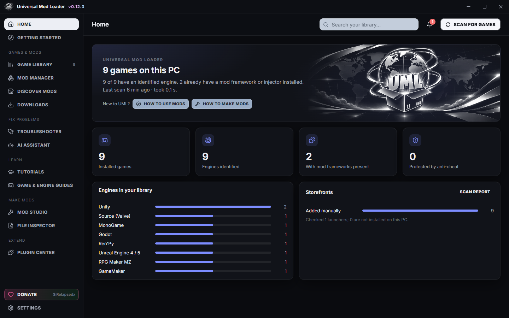

## Download

1. Open [the latest release](https://github.com/iRelapsedx/UML/releases/latest) and download `UML_<version>_x64-setup.exe`.
2. Run it. It installs UML for your Windows account only (no administrator rights needed) and adds it to the Start menu.

The installer isn't code-signed yet, so Windows SmartScreen may say it's from an unknown publisher. If you downloaded it from this page, choose **More info → Run anyway**.

**Updates:** UML checks this page for a newer version (you can switch this off in Settings → Updates). You see what's new and decide when to install. An update is installed only if it carries UML's signature; your library, mods and settings are kept.

## What it can do

### Your game library
UML reads the install records of Steam, Epic, GOG, Ubisoft Connect, EA app, Battle.net, Rockstar, the Xbox app, Amazon Games and itch.io, plus any folder you add. It recognises 45 engines (Unity, Unreal, Godot, GameMaker, Source, RPG Maker, Ren'Py, Creation Engine and many more), mod frameworks such as BepInEx and MelonLoader, and anti-cheat systems.

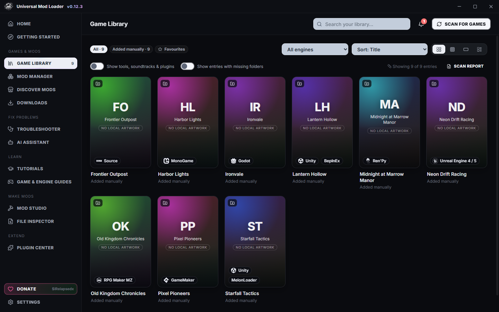

### Every game explained, with evidence
Each game page shows the engine, the mod frameworks already installed and the main executable. The Detection tab lists exactly which files UML based each result on, and how sure it is.

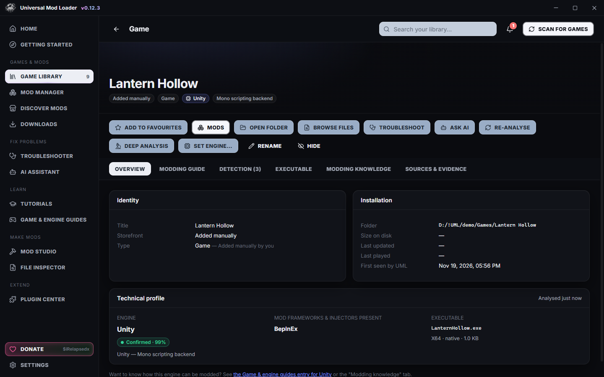
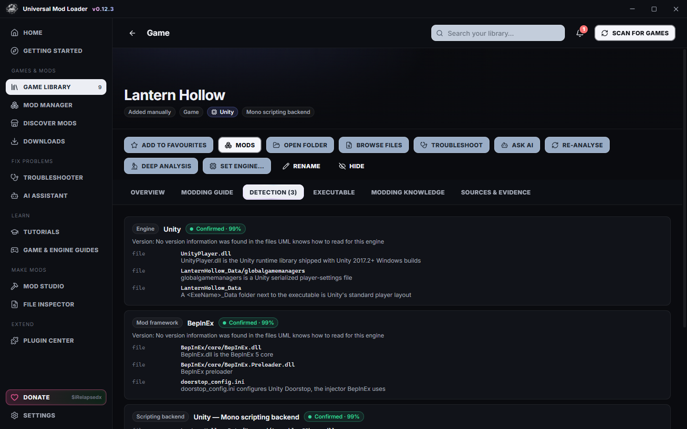

### Mod Manager with backups and a full undo
Import mods from .zip, .7z, .rar, folders or single files. UML suggests where the files go, keeps per-game profiles and a load order, and backs up every original file before replacing it. Every change is recorded, and **Restore original files** puts the game back exactly as it was.

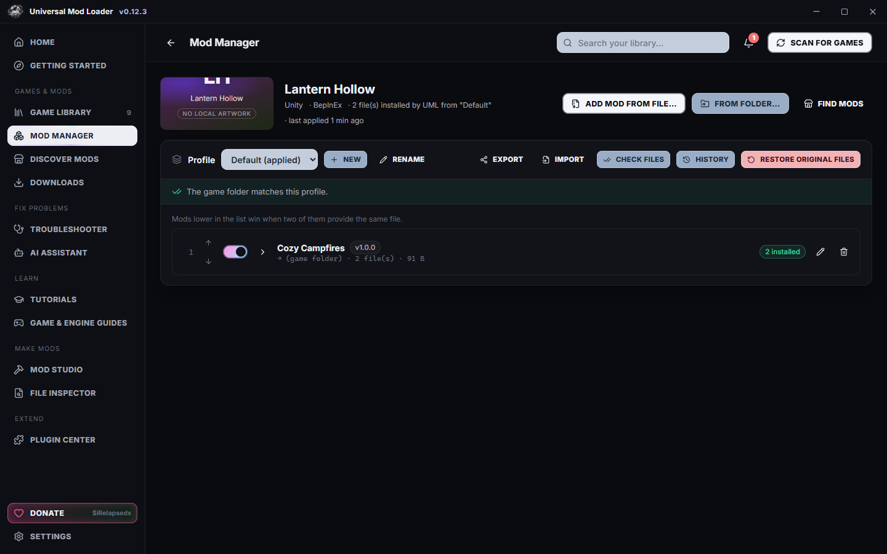

### Discover Mods
For each game UML offers the official mod-loader releases that fit it (checked against their published checksums), Thunderstore and mod.io where the game is listed, and GitHub releases. It warns about things like two mod loaders in one game. Online features are off until you switch them on.

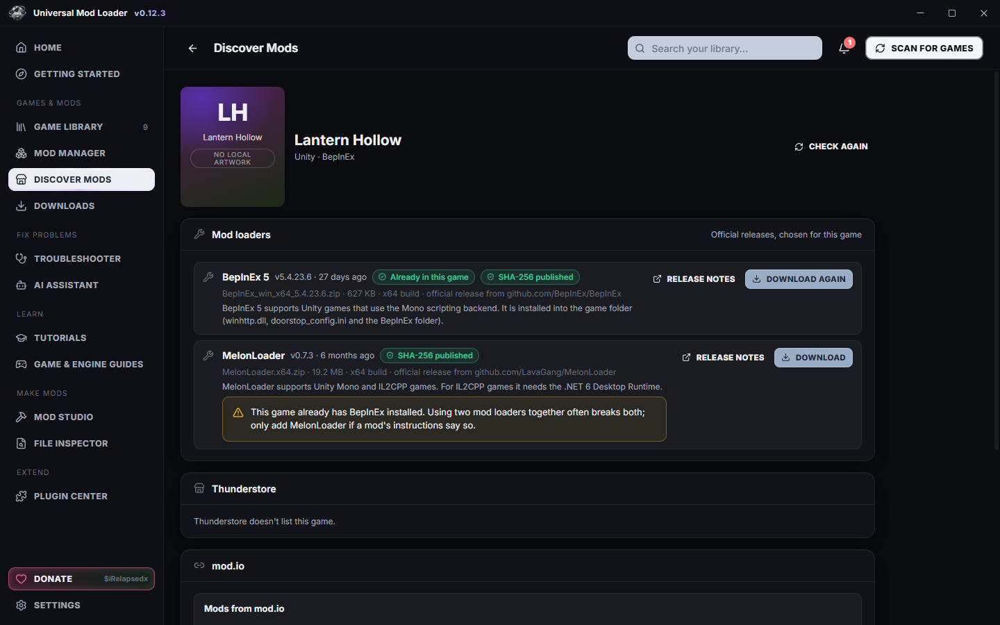

### Troubleshooter
UML reads a game's logs and Windows' crash records and explains each problem: what happened, why, how to fix it and how to prevent it. It keeps what the log states (confirmed) apart from what UML infers (possible).

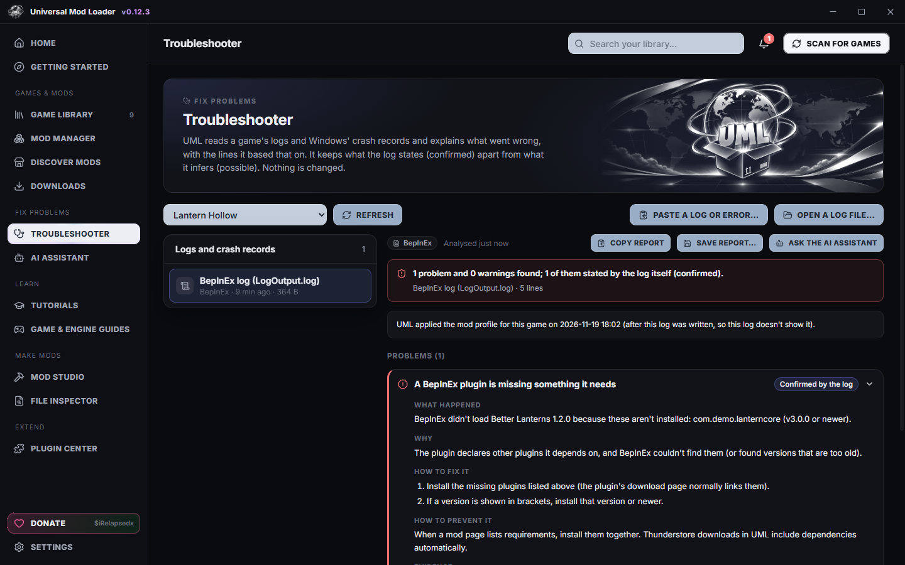

### Optional AI assistant
Ask about modding a game or a crash, with Claude (your own API key) or a free local model through Ollama. You see exactly what is sent first, with personal details removed. Everything else in UML works without AI.

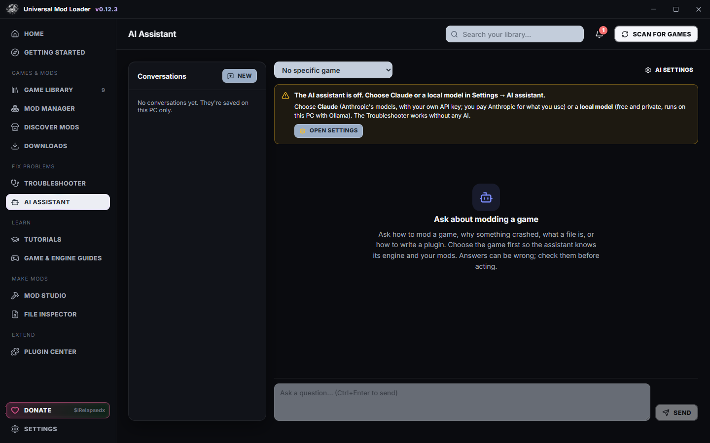

### Tutorials and guides
Step-by-step tutorials where UML checks each step itself: the files, its own install records and the game's log. Game guides say what each publisher allows, with sources and dates. The engine guides explain how each engine is modded.

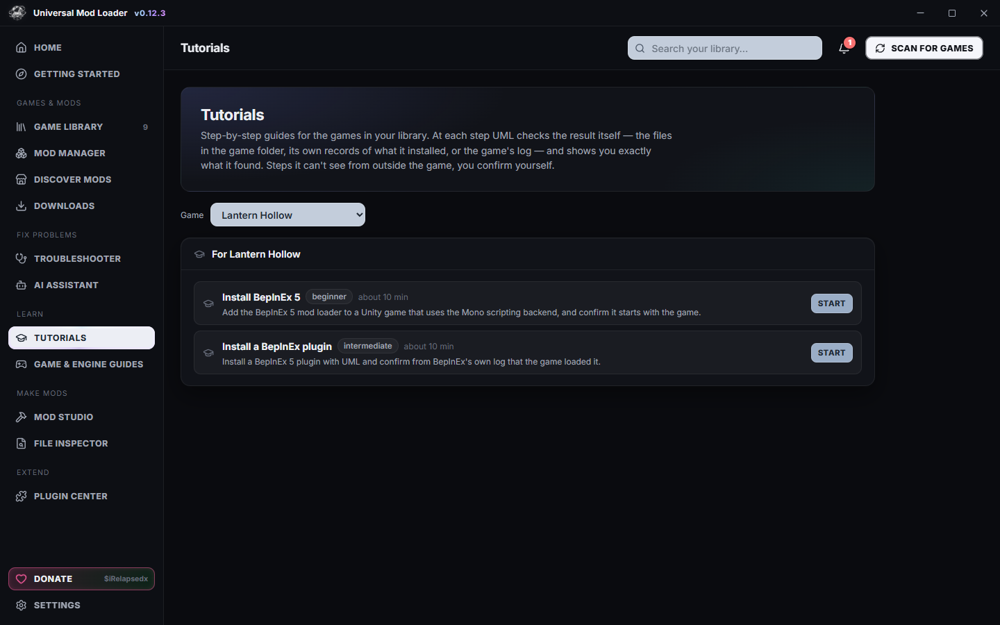
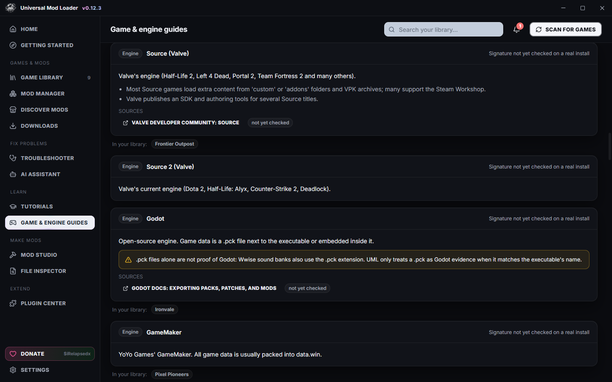

### Mod Studio
Start a mod from a template made for your game: BepInEx or MelonLoader plugins for Unity games, Unreal pak mods, Bethesda loose files, or plain files for any game. UML fills in the game's folders, builds C# projects with the .NET SDK when you ask, checks the result and packages it.

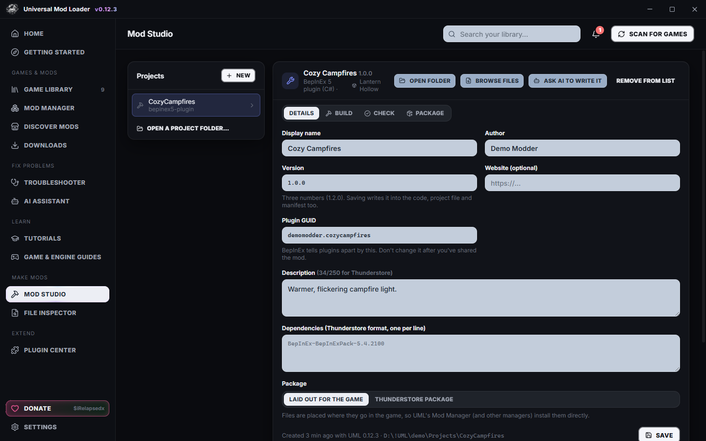

### File Inspector
A read-only look inside game files: what a file really is, what a DLL needs, what an archive holds (ZIP, 7z, RAR, Bethesda BSA/BA2, Valve VPK, Unity bundles, Unreal .pak), with previews of textures, sounds, text and 3D models. It never runs anything.

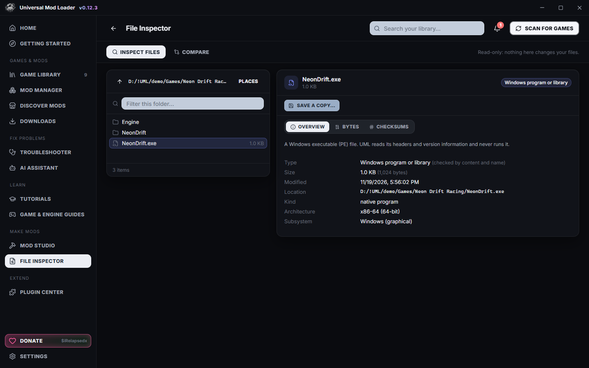

### Plugin Center
Plugins teach UML about more games, engines and tools. They contain only data, never programs, and each kind of data needs a permission you approve.

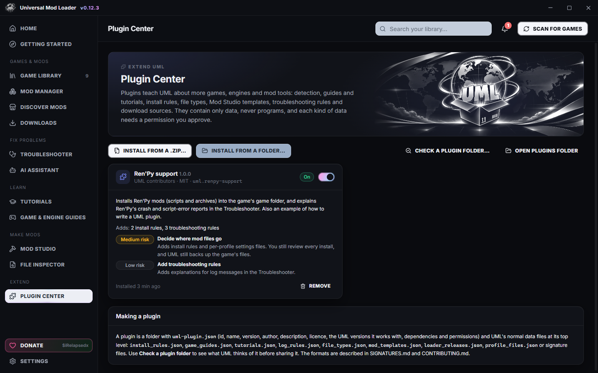

### Made to be easy
A short Getting started guide for people who want to use mods and people who want to make them, Windows notifications, and dark and light themes.

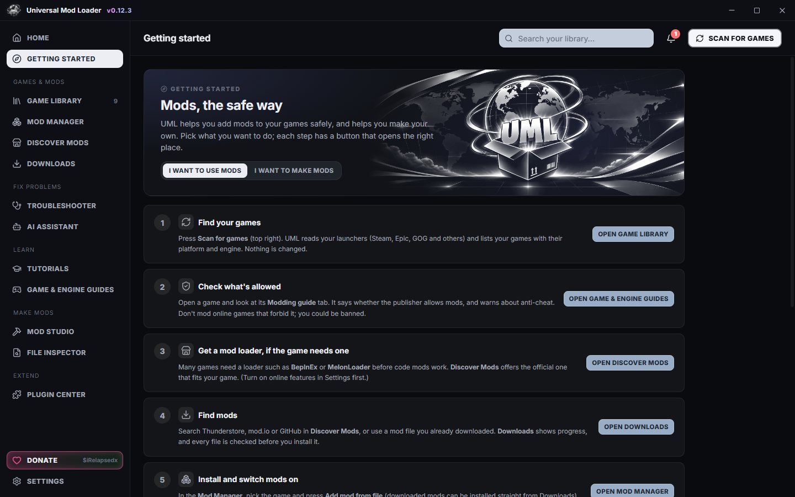
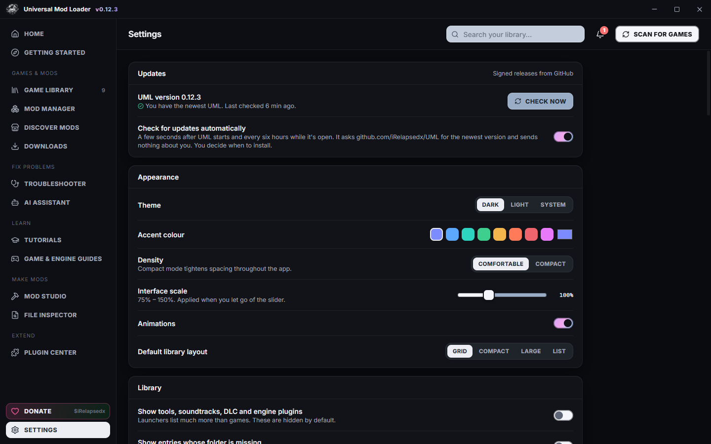
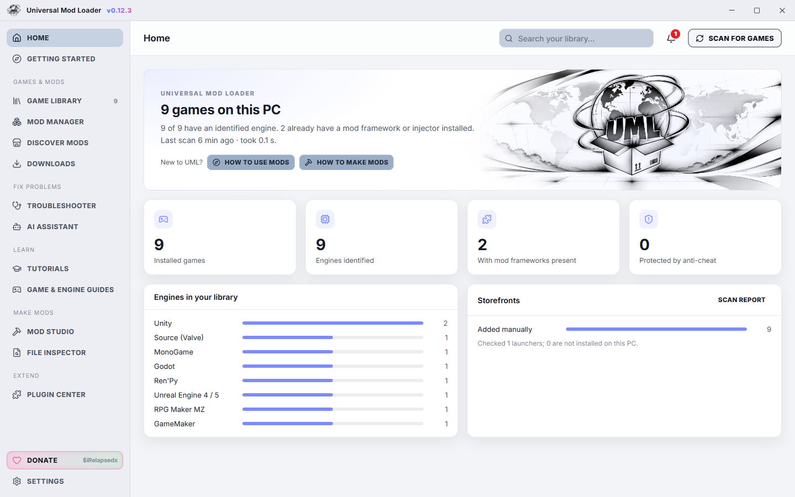

## Safety

* UML has no way around anti-cheat or DRM and no online cheating features. Applying mods to a game with anti-cheat needs your explicit OK, and games whose terms forbid mods get no mod loaders from UML.
* Every original game file is backed up and checked before a mod replaces it, and every change can be undone.
* Downloads are checked against the checksums their sources publish before anything is installed.
* Nothing is uploaded about you. Online features and update checks can be switched off.
